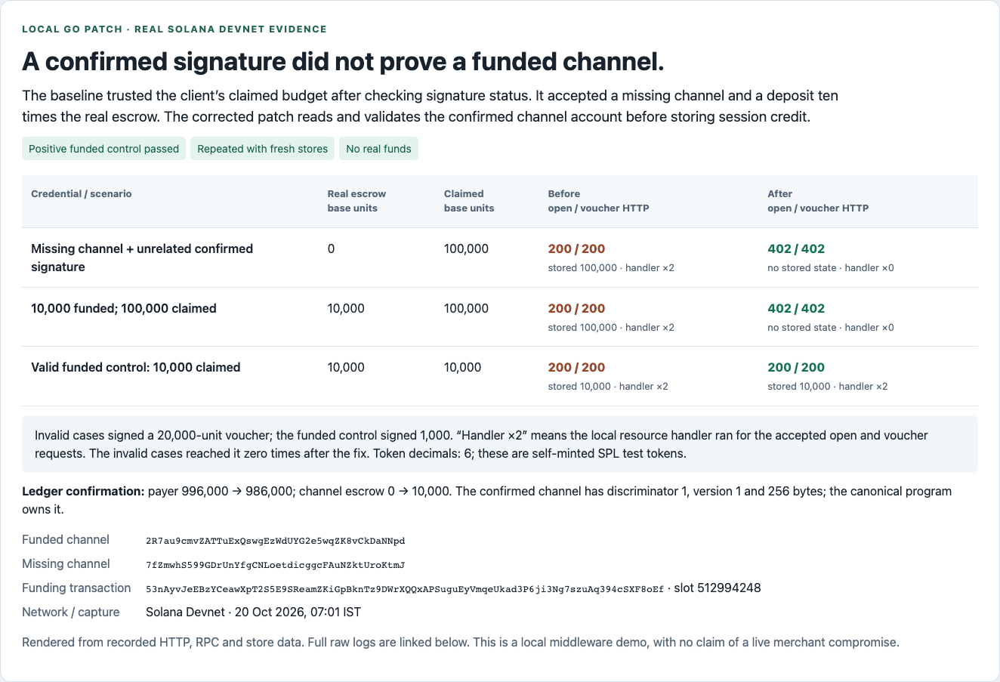
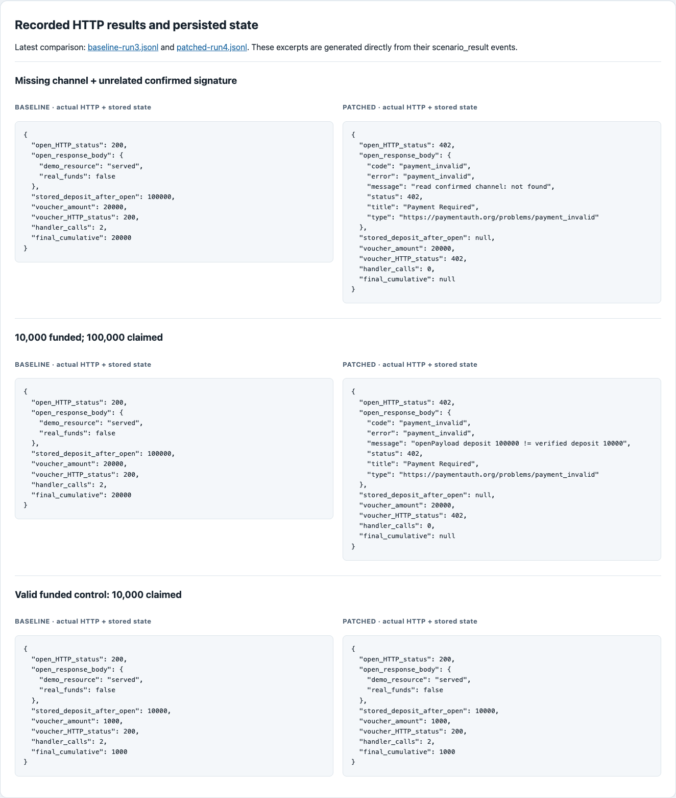

# Go MPP confirmed-channel verification: Devnet evidence

A local HTTP server using the production Go SessionMiddleware accepted session credit for a nonexistent channel and an overstated deposit before the fix. The corrected server rejects both and continues to accept a genuine funded channel and signed voucher.

| Case | Before | After |
| --- | --- | --- |
| Missing channel, claiming 100,000 base units | Open and voucher HTTP 200; persisted credit | Open and voucher HTTP 402; no state or resource calls |
| Actual deposit 10,000, claiming 100,000 | Open and excessive 20,000 voucher HTTP 200 | Open and voucher HTTP 402; no state or resource calls |
| Actual deposit and claim 10,000, voucher 1,000 | Open and voucher HTTP 200 | Open and voucher HTTP 200 |

Each comparison was repeated twice, with independent stores and one reusable funded Devnet channel. Baseline: bd3ad25baeb65c1c293239e1b4990f14d26a22ad. Final reviewed fix commit: 551ccec (full hash in publication.json). The production sources in the final commit exactly match the corrected recorded runs; the audit subsequently added regression tests.

- [Recorded report](evidence/report.html), [structured report](evidence/report.json), [original instructions and limitations](evidence/README.txt)
- [Independent Sol 6.1 extra-high audit](audit/independent-audit.json), [audit summary](audit/audit-summary.txt), [final source hashes](audit/source-manifest.json)
- [Full Go short-suite output](audit/all-tests.log), [focused regressions](audit/new-regressions.log), [vet output](audit/vet.log), [intentional mutation failure](audit/mutation-test.log)
- [Recorded channel open on Explorer](https://explorer.solana.com/tx/53nAyvJeEBzYCeawXpT2S5E9SReamZKiGpBknTz9DWrXQQxAPSuguEyVmqeUkad3P6ji3Ng7szuAq394cSXF8oEf?cluster=devnet)

The positive control caught an incorrect generated discriminator assumption. The corrected check uses explicit on-chain discriminator 1. Offline regression tests include exact captured account bytes and a public HTTP open-plus-voucher matrix; reverting the constant to zero makes the tests fail.

Screenshots below are browser captures of the report generated from raw recorded RPC/HTTP data. They are not third-party merchant or Explorer screenshots.

## Rechecking the recorded evidence

Run `python3 evidence/verify_evidence.py` from this directory. It reads the archived raw logs and does not contact a network. The account golden bytes and baseline overlay source can be inspected independently. Local absolute paths in historical manifests, overlays and original instructions document the original run environment; they must be adjusted to rebuild on another machine. Go binaries and all disposable private keys are excluded.

`evidence/` preserves the original logs, including unsuccessful exploratory runs and the pre-correction source. Final comparisons use baseline-run2/run3 and patched-run3/run4 only. `audit/` contains the final reviewed source snapshots and new test outputs. A failing mutation-test.log is expected and demonstrates that the corrected discriminator is covered. Historical statements saying nothing was published describe the capture/audit stage, before this separate evidence branch was published.

Only disposable Devnet wallets and self-minted SPL test tokens were used. No real USDC or mainnet. No on-chain settlement or withdrawal was tested; an accepted excessive voucher demonstrates middleware acceptance and recorded credit, not successful excessive on-chain payout. Real-chain coverage is signature-only push opens; other paths are covered by offline regression tests. Existing top-up and host-managed delegation trust behavior is outside this fix.

This branch deliberately contains demo/evidence files only, keeping the upstream code PR focused. Related work: issue #365 and EfeDurmaz16's earlier closed PR #239.
